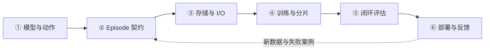

# 具身 Infra 个人学习指南：六个阶段，八次具体学习

**已经看过宽泛介绍，就从本页开始。** 这里把正文组织成可逐次完成的学习：每次先回答一个问题，读指定章节，再留下图、计算或排查方案。整体概念需要回顾时再看[核心 topic](topics/embodied_infra.md)；本页是唯一学习路线，机制放在独立章节中。

2026-10-23 学习整理：模型、数据、训练、仿真评估、部署执行已有分章正文，平台设计放在最后按需阅读。正文与参考推导已经写出，个人掌握程度和实验结果仍待记录。

[所属 Part](README.md) · [首页](../README.md) · [知识地图](../KNOWLEDGE_GRAPH.md) · [实验课程](../practice/experiments/a100_fsdp_io_lab.md)

沿一条可解释的链路学习：**观察与任务 → 训练样本 → batch → 模型更新 → 闭环评估 → 动作执行**。用杯子操作串起各章：模型章从“把杯子递给我”解释理解与动作，评估章把任务收窄为“放入托盘”以便定义判据；这些是学习场景，不代表仓库已有真机实现。

已有 LLM Training / Agentic RL 经验可以复用。需要新补的是模型到底预测什么、时序数据是否对齐，以及推理结果怎样影响下一次观察。模型参数少，不等于 activation、视频 I/O、数据质量与闭环时延都容易处理；是否使用 FSDP 要看状态账本和实测，不预设答案。

## 先明确这轮学习的目标

学完第一轮，你应能沿着**一条 episode → 一个 batch → 一次更新 → 一组评估 → 一次动作执行**解释数据、状态与时间，并指出某个失败应该在哪层排查。范围先聚焦视觉驱动的机器人操作；运动控制、运动学、接触动力学需理解接口和约束，暂不以推导完整控制算法或搭 fleet 平台作为入门门槛。

| 已有经验可以复用 | 具身场景必须补的区别 |
|---|---|
| Dataloader、sampler、分布式 batch | 相机/state/action 不天然同步，episode 结束会截断监督 |
| 模型并行、冻结、AMP、checkpoint | 多模态模块的梯度路径、norm stats、动作适配共同决定训练语义 |
| 推理 batching、cache、tail latency | 动作有目标时刻与提交边界，迟到响应可能已经没有执行价值 |
| RL rollout、reward、恢复 | reset 资源、物理状态、人工介入与终止/截断改变经验和评估 |

第一轮先用纸面推演建立判断，再选一个本地数据或 GPU 实验验证；不是先把所有框架安装一遍。

## 六阶段地图

| 阶段 | 学完能回答什么 | 正文入口与真实覆盖 | 最小产出 |
|---|---|---|---|
| [① 模型与动作](#stage-1) | 模型输入、输出、目标分别是什么？ | [模型入门正文](topics/embodied_models_primer.md)，从任务到动作与学习 | 一页输入／输出／目标对照 |
| [② Episode 契约](#stage-2) | 图像、状态与未来动作按什么时间契约对齐？ | [数据契约基础](topics/embodied_data_io.md#sample-contract) → [平台 schema](topics/agentic_for_embodied.md)，未验证 | 一个 episode 的字段和时间线 |
| [③ 存储与 I/O](#stage-3) | 从文件到 GPU batch 在哪里等待？ | [数据与 I/O](topics/embodied_data_io.md)＋[E04](../practice/experiments/a100_fsdp_io_lab.md#e04)，实验待执行 | 样本身份校验与流水线分解 |
| [④ 训练与分片](#stage-4) | 哪些参数在更新，padding 不同怎样保持训练目标？ | [具身训练](topics/embodied_training.md) → [FSDP/FSDP2/ZeRO](../02-training-infra/topics/fsdp.md) | 全局 loss、梯度路径、状态与恢复账本 |
| [⑤ 闭环评估](#stage-5) | 成功率漏掉了谁，仿真结论能外推到哪里？ | [具身仿真与评估](topics/embodied_sim_evaluation.md)，尚无本仓库实测 | 12-case 结果表、环境版本与失败分类 |
| [⑥ 部署与反馈](#stage-6) | 正确动作晚到了，该如何处理？ | [具身部署与执行](topics/embodied_runtime.md)，未完成真机验证 | 请求→候选→提交→执行的时间与状态图 |

前两阶段先做到能解释一个样本，再开始性能实验；阶段④沿用已有训练知识，不必从 Megatron 重新学起。⑤⑥是训练的验收约束，不是“训练结束以后再考虑”的附加项。

## 第一轮：八次具体学习

每次可先预留 45—75 分钟，这是阅读建议而非进度承诺。先自己解释／计算，再对照正文；不用逐篇补读论文。已有经验足够的内容可以用产出检验后跳过。

| 次数 | 这次只解决什么 | 指定阅读 | 留下的产出 |
|---|---|---|---|
| 1 | 模型、学习方式与动作生成有什么区别？ | [VLM/VLT/VLA](topics/embodied_models_primer.md#model-roles) → [样本到动作](topics/embodied_models_primer.md#sample-to-action) | 写清两路图像、state、`H×D` 动作、BC loss；解释 H 和 K |
| 2 | 哪些帧与动作属于同一个样本？ | [Episode 契约](topics/embodied_data_io.md#sample-contract) | 完成 [E1](../practice/experiments/embodied_contract_lab.md#e1)，画时序、mask、单位与坐标 |
| 3 | GPU 等数据时，先优化哪一段？ | [I/O 流水线](topics/embodied_data_io.md#pipeline)与[内存/解码算例](topics/embodied_data_io.md#io-case) | 重算 36.75 MiB 与 74/40 ms，给 [E3](../practice/experiments/embodied_contract_lab.md#e3)写同样本对照 |
| 4 | 冻结参数是否意味着不需要反传？ | [Trainer step](topics/embodied_training.md#step) → [冻结与梯度](topics/embodied_training.md#trainable) | 画 vision/VLM/action 三块的梯度路径与 optimizer groups |
| 5 | 加卡或 resume 后怎样证明仍在做同一训练？ | [全局 loss](topics/embodied_training.md#loss-normalization) → [恢复](topics/embodied_training.md#recovery) | 完成 [E4](../practice/experiments/embodied_contract_lab.md#e4)，解释 0.28 与 0.4，并列续训状态 |
| 6 | 一份成功率报告究竟测了什么？ | [环境与时钟](topics/embodied_sim_evaluation.md#env-contract) → [结果账本](topics/embodied_sim_evaluation.md#episode-ledger) | 完成 [E5](../practice/experiments/embodied_contract_lab.md#e5)，解释 5/9、5/12 与缺失 case |
| 7 | 模型算完以后，动作何时才有效？ | [时间预算](topics/embodied_runtime.md#time-budget) → [reset 反例](topics/embodied_runtime.md#stale-response) | 完成 [E2](../practice/experiments/embodied_contract_lab.md#e2)和 [E6](../practice/experiments/embodied_contract_lab.md#e6)，区分接纳、提交与执行 |
| 8 | 能否从头解释一条链，并定位反例？ | 回看下面[综合自测](#self-check)；只在卡住时查对应章节 | 一张端到端图、一份 artifact 清单、一个优先验证的问题 |

首轮优先顺序是 **模型与样本 → 训练是否正确 → 评估和执行是否可信 → 性能优化**。上表第 3 次只做 I/O 纸面分解，真实 GPU 扩展实验放在数值与语义检查之后。练习原始结果只在[练习账本](../practice/experiments/embodied_contract_lab.md)记录，不以阅读时长或文档数量替代掌握程度。

## ① 先认识模型：它在学什么、输出什么

- **MLLM**：多模态理解、对话、澄清、任务状态判断；不直接输出动作也有价值。MLLM 不是推理引擎 vLLM。
- **VLA / policy**：由视觉、语言及具体方案使用的机器人状态产生动作；动作可能是关节目标、末端位姿或增量。坐标系、单位和控制接口比缩写更重要。
- **World model**：预测观察或潜在状态的演化；是否以动作作为条件、是否用于规划，取决于模型。不能把所有视频生成模型当成可用的机器人动力学模型。
- **学习方式与输出方式分开**：BC 从示范学习；RL 从奖励与交互学习。Action chunk 是一次预测多个时间步；Diffusion / Flow Matching 是可用于连续动作生成的方法，不是 RL 的同义词。

阅读顺序：[模型入门](topics/embodied_models_primer.md) → [数据正文](topics/embodied_data_io.md) → [系统正文最小机器人背景](topics/agentic_for_embodied.md)。先用 [VLM／VLT／VLA 对照](topics/embodied_models_primer.md#model-roles)理解职责，再看[学习与生成方式](topics/embodied_models_primer.md#model-vs-algorithm)；VLT 仅在给出出处时定义，IRON 的 Vision-Language-Task 不能套用到所有论文。

具体推演从[样本到 loss 与动作](topics/embodied_models_primer.md#sample-to-action)开始，再比较[动作生成计算路径](topics/embodied_models_primer.md#action-compute)和 [BC／RL 系统差异](topics/embodied_models_primer.md#bc-rl-infra)。算例提供理解参照，仍需自己完成下面的过关产出。

**过关标准**：对一个选定的公开策略，写清 observation shape、action shape、预测长度、实际执行长度、loss 和可训练模块；说明“看懂杯子”与“夹爪动作可执行”的区别。先对比 action chunk、动作生成与视觉语言条件这三个机制，再按需要选 ACT、Diffusion Policy、OpenVLA / openpi 的代表材料，不把模型名单全部升为必读。

## ② Episode 数据契约：正确的 batch 比快的 batch 更早

从一条 episode 画出 camera / state / action 的时间线，核对：episode ID、时间戳、相机标定、坐标系、单位、动作空间、归一化统计、终止原因和 padding mask。采样历史观察与未来动作时，不越过 episode 边界；训练／验证按任务和采集分组设计，避免相邻窗口泄漏。

先读[数据契约基础](topics/embodied_data_io.md#sample-contract)，再深入[平台 schema](topics/agentic_for_embodied.md)。[LeRobotDataset v3 官方文档](https://huggingface.co/docs/lerobot/en/lerobot-dataset-v3)可作为具体格式样本：低维信号、视频与索引元数据是不同层；逻辑 episode 不必等于一个物理文件。

**过关标准**：抽一个样本，能追溯回原始 episode 和相机帧，解释边界处的 mask、状态与动作的时间差；先做只读可视核验，不控制机器人。

## ③ 多模态存储与 I/O：分清读得慢、解码慢还是送得慢

只抓六件事：**文件分片与索引 → 时序窗口采样 → 视频解码 → CPU 变换 → cache/prefetch → H2D**。小文件压力与大 shard 的随机访问成本需要一起看；视频压缩节省空间，但窗口抽样可能带来额外解码。增加 worker 不一定加速，也可能争抢 CPU、内存、文件句柄和存储带宽。

按 [E04](../practice/experiments/a100_fsdp_io_lab.md#e04)设计对照：固定 episode／窗口／数据增强语义，分别记录读文件、decode、collate、H2D、GPU 等待；区分冷／热缓存，不清理共享缓存。比较单进程与多 worker、按需解码与复用、无预取与有界预取，最后再测跨 rank 采样重复、遗漏及长尾。

**过关标准**：解释 GPU 空洞的来源，并能证明优化前后的样本身份、时序和 mask 没变。[独立 I/O 正文](topics/embodied_data_io.md)已建立，本阶段不预设 MP4、逐帧图片或某个新存储格式一定最快。

## ④ 训练：先有 DDP 基线，再决定是否分片

先读新正文[具身训练：从 batch 到参数更新](topics/embodied_training.md)：用一个 trainer step 连接模块冻结、有效 loss、分布式聚合与恢复，再复用 [FSDP/FSDP2 与后端选型](../02-training-infra/topics/fsdp.md)、[NCCL](../01-systems/topics/nccl.md)和 [FP8 / 混合精度基础](../01-systems/topics/fp8.md)：

1. 列出 vision encoder、语言骨干、action head 的冻结范围，分开计算参数、梯度、optimizer、activation 与临时 buffer。
2. 小规模跑通单卡／DDP 基线，先验证 batch、loss 和一步更新，再判断受限于状态、activation、I/O 还是计算。
3. 对比 ZeRO-1/2/3 的状态分片与 PyTorch FSDP1/FSDP2 的实现；画清 all-gather 参数、reduce-scatter 梯度与参数释放时机。FSDP2 不是“ZeRO 的第四阶段”。
4. 结合模块边界选择 `fully_shard` 分组，再考察 `reshard_after_forward`、prefetch、mixed precision、梯度累积；具体可用参数和默认值以固定版本的[官方教程](https://docs.pytorch.org/tutorials/intermediate/FSDP_tutorial.html)为准。
5. Activation 主导时再做选择性重计算、分辨率／时间窗／microbatch 消融；状态分片不等于切掉全部 activation。最后加入 optimizer、RNG、数据位置与归一化配置的 checkpoint 恢复验收。

**过关标准**：先完成[两 rank loss 练习](../practice/experiments/embodied_contract_lab.md#e4)，再写 [A100 E01 状态账本](../practice/experiments/a100_fsdp_io_lab.md#e01)／[E02 通信时间线](../practice/experiments/a100_fsdp_io_lab.md#e02)设计，按需做 E03/E05/E06。实验均未执行；先单机，只有单机假设解释清楚且获准后才扩到最多 64 卡。A100 以 FP32/BF16/FP16 为主要实验精度，不宣称原生 FP8/FP4 Tensor Core 加速。

## ⑤ 评估：离线拟合与闭环任务成功分开

先确定任务、初始状态、成功判据、时间预算、reset、随机种子和人工介入规则，再看结果。离线 loss／动作误差反映数据上的拟合；闭环中策略会改变下一步观察，错误会累积，不能互相替代。

具体读[仿真与评估正文](topics/embodied_sim_evaluation.md)：从环境组成、reset 和不同频率开始，再看 12-case 账本、终止与截断、replay 与真实闭环的差别。至少区分训练分布内、新物体／场景／指令、跨本体；固定评估版本和种子集合，保存成功、失败、timeout、接管和缺失结果。平台资源与调度再查[进阶设计](topics/agentic_for_embodied.md#7-simulationrollout-与-environment-infrastructure)。

**过关标准**：完成 [E5](../practice/experiments/embodied_contract_lab.md#e5)，交付可复跑的协议、分母与失败分类，解释为什么记录动作回放不能替代新 policy 闭环。尚未执行仿真或真机测试，不把设计标为 `VERIFIED`。

## ⑥ 部署：优化的是动作可用性，不只是模型吞吐

沿着 camera timestamp → preprocess → inference → action buffer → controller 记录延迟、抖动与 observation 新鲜度。明确 chunk 预测长度、执行长度、补位水位与重规划；并发或异步可以减少等待，但不会自动消除旧观察带来的动作失配。

具体读[部署与执行正文](topics/embodied_runtime.md)：一条 80 ms 时间线、迟到请求、reset 失效与 artifact 清单；[固定版本 LeRobot 部署指南](https://github.com/huggingface/lerobot/blob/ae2b57f12223c8c5184fcd814eb63cd9ce7de203/docs/source/remote_inference.mdx)仅作实现对照。动作预测异步与 [RL 异步训练](../04-rl-infra/topics/agentic_rl.md#async-streaming-partial-staleness)不是同一概念；LLM 的 TTFT/TPOT 也不能直接充当控制闭环指标。

**过关标准**：完成 [E6](../practice/experiments/embodied_contract_lab.md#e6)，设计迟到动作的丢弃／替换、超时与恢复规则；模型、预处理、normalization、action adapter 和 robot profile 一起版本化。先用回放或仿真验证；真机必须有独立安全保护、操作许可和急停，不执行未经验证的动作。

## 综合自测：不用论文标题，也能讲清系统

以“把杯子放到托盘”为例，先独立口述，再对照正文：

| 自测题 | 回答至少应包含 |
|---|---|
| 视频、state、action 怎样组成一个样本？ | episode/anchor/时间窗、相机身份、坐标单位、边界与 mask |
| 两个同为 7 维的 action 能直接拼数据吗？ | 绝对/增量、参考系、旋转、夹爪、频率与 adapter |
| 冻结 backbone 后 adapter 为什么可能不学？ | 参数冻结与反传图不同，检查 no_grad/detach 和实际更新 |
| Batch shape 相同，加卡为何改变 loss？ | 有效元素数、任务/轨迹权重、DDP 规约和累积口径 |
| 读数据更快，训练为何不一定更快？ | CPU/decode/H2D/GPU 关键路径、队列与最慢 rank |
| resume 能加载权重，是否就恢复了训练？ | optimizer、RNG、sampler、stats、EMA 和提交边界 |
| success 上升时怎样排除评估变简单？ | 固定 case/判据/预算，检查介入、缺失、重试与分组 |
| 40 ms forward 能说明机器人 25 Hz 控制吗？ | 传感器、处理、排队、执行与尾延迟还未计入 |
| 同一模型的迟到响应为何要丢？ | episode、execution generation、观测年龄与提交状态 |
| 仿真提升如何支持真机判断？ | 接口、时间、动力学、分布的受控对照及实际证据边界 |

能说清这些以后，再读[平台章](topics/agentic_for_embodied.md)的资源池、ownership、RolloutJob 与 fleet；此时会知道每个服务为何存在。技术新进展按[2026 月报时间线](../research/tracking/monthly_reviews.md#embodied-2026)回看，当前论文选择仍由[共享 P1](../research/reading_queue/P1.md#embodied-20261013)维护。

每次讨论只记录“我能解释什么、哪里仍不确定、下一步怎样验证”，写入[学习日志](../research/learning_log/2026-10.md#embodied-discussion)。本次整理没有替你把任何题目判为掌握，也没有推进扫描游标。

## 如何衔接其它路线

[GPU Systems](../01-systems/roadmaps/gpu-systems.md)解释执行与数据搬运；[Distributed Systems](../01-systems/roadmaps/distributed-systems.md)解释失败、状态与恢复；[Inference](../03-inference-infra/roadmap.md)提供调度与性能方法，但不替代物理动作时限；[Agentic RL](../04-rl-infra/roadmap.md)在确有交互学习需求时复用，不作为 BC 的强制前置。

本页只组织学习和验证，不新建一套研究队列。正式选读仍进入[共享阅读队列](../research/reading_queue/README.md)，研究变化在[统一雷达](../research/tracking/README.md)跟踪；模型、I/O 基础正文已建立，后续阅读掌握与实验结果分别记录，不能以“已建立路线”代替“已掌握”。
