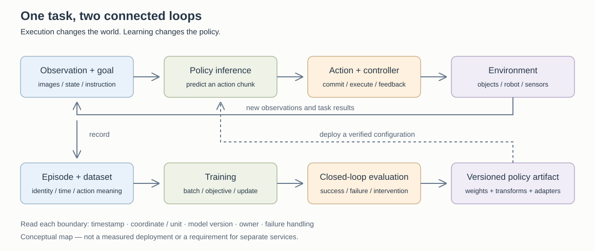

# 具身 Infra：从一个动作到完整学习系统

[所属 Part](../README.md) · [六阶段路线](../roadmap.md) · [模型入门](embodied_models_primer.md) · [数据与 I/O](embodied_data_io.md)

这里是具身 Infra 的核心 topic，也是我们持续学习和讨论的入口。先理解机器人一次任务如何闭环，再沿模型、数据、训练、仿真、执行逐层深入。以“把桌上的杯子递给我”为例；它是教学场景，不代表仓库实现了真机系统。

**当前进度**：已有模型基础、数据 I/O 与系统设计正文；已做历史来源与 GitHub 补扫。阅读掌握程度待讨论确认，实验尚未执行。来源更新在[统一研究雷达](../../research/tracking/README.md)，正式待办在[共享 P1](../../research/reading_queue/P1.md#embodied-20261013)。本页负责解释核心概念及把问题引向正文，不再维护第二套雷达、队列或进度表。

## 1. 先花十分钟建立整体认识

具身 Infra 支撑的是一条有物理反馈的学习链：把真实或模拟交互变成可信的数据，把模型变成及时可用的动作，再把任务结果带回评估与学习。它包括数据、训练、环境、部署和可观测性；既有离线 BC，也可能有交互 RL。

术语速查：[VLM／VLT／VLA 的区别](embodied_models_primer.md#model-roles) → [BC／RL 与动作生成的关系](embodied_models_primer.md#model-vs-algorithm) → [Infra 岗位的五个核心关注点](embodied_models_primer.md#infra-priorities)。VLT 在该对照中限定为 IRON 的 Vision-Language-Task 用法，其他来源仍需核原文。

图是功能地图，不要求每个框都部署成独立服务。**执行循环**改变环境状态；**学习循环**改变模型参数。执行中重规划不等于在线训练，动作推理异步也不等于异步 RL。

先把五个对象分开：

| 对象 | 杯子例子 | 最先核验的契约 |
|---|---|---|
| Observation | 相机图像、关节状态、用户指令 | 何时采集，坐标与单位是什么？ |
| Policy | 根据观察与目标预测动作 | 输入和训练时一致吗？ |
| Action | 末端位姿目标、关节目标或增量及夹爪命令 | 哪个参考系，何时生效，谁能修改？ |
| Controller | 将目标转换为底层执行 | 控制模式、限制与反馈接口匹配吗？ |
| Episode | 从任务开始到成功、失败或超时的一段交互 | 边界、结果、版本和时间线能复原吗？ |

核心差别是：**正确数值在错误时间、坐标系或版本下，也可能成为错误动作。** 这是一条工程判断，需用具体系统的接口与闭环实验检验，不能仅由离线 loss 证明。

## 2. 由浅入深：按当前问题选择阅读深度

时间是阅读建议，不是完成记录；掌握标准与完整先后关系只在[六阶段路线](../roadmap.md)维护。

| 深度 | 先解决一个问题 | 正文入口 | 讨论时拿出什么 |
|---|---|---|---|
| 入门，约 20–30 分钟 | MLLM、VLA、policy、world model 分别输出什么？ | [模型入门](embodied_models_primer.md) | 一个模型的输入、输出和目标 |
| 基础，约 30–45 分钟 | 一个训练样本为什么可能时间错位？ | [数据契约与 I/O](embodied_data_io.md#sample-contract) | 一条 episode 的观察与动作时间线 |
| 机制，约 45 分钟 | 模型不大，为什么 GPU 仍在等数据或爆显存？ | [I/O 测量](embodied_data_io.md#pipeline)、[训练阶段](../roadmap.md#stage-4)、[FSDP](../../02-training-infra/topics/fsdp.md) | 样本吞吐分解和状态账本 |
| 系统，约 45 分钟 | 为什么更快生成不一定让机器人更可靠？ | [动作时限](#execution)、[闭环评估阶段](../roadmap.md#stage-5) | 观测年龄、动作提交与失败分母 |
| 进阶，按问题展开 | 如何组织仿真、训练、发布、恢复与 fleet？ | [现有平台设计](agentic_for_embodied.md) | workload、owner、版本和故障边界 |

## 3. 从资讯进入核心技术

阅读新闻时先找“哪个假设变了”，再进入相应正文：

| 常见信号 | 值得追问的机制 | 正文与核验方向 |
|---|---|---|
| 新 VLA／新 action head | 动作表示、目标、解码或数据配方改变了吗？ | [动作生成](embodied_models_primer.md#actions)，用 ACT / OpenVLA / π 系列对照 |
| 新数据集或数据格式 | 多样性、语义标准化、索引还是读取路径改变？ | [数据 I/O](embodied_data_io.md)，区分 OXE / DROID 与 LeRobot 存储格式 |
| 训练吞吐提高 | 是少读数据、换样本、冻结模块，还是同语义下加速？ | [训练阶段](../roadmap.md#stage-4)，固定有效样本与训练目标 |
| 异步／实时推理 | 降低空等，还是正确处理延迟与已提交动作？ | [执行契约](#execution)，区分 SmolVLA async 与 RTC |
| 新 world model | 动作条件、预测对象、闭环用途及误差边界是什么？ | [世界模型](embodied_models_primer.md#world-model)，不能仅看视频效果 |
| benchmark 或成功率更新 | 任务、初始分布、reset、人工介入和失败分母变了吗？ | [评估](#evaluation)，先核协议再比较数值 |

历史来路看[第一批 13 项复盘](../../research/tracking/embodied_retrospective_2026-10-13.md)，后续演进与源码证据看[模型和 GitHub 补扫](../../research/tracking/embodied_followup_2026-10-13.md)。它们是来源账本，正文负责形成可迁移的判断。新材料即使不提升 Infra 性能，只要澄清模型学习问题，也值得评估。

### 2026-10-14：从“更多经验”追问到“经验还能不能正确使用”

[最新扫描](../../research/tracking/frontier_scan_2026-10-14.md)提供三个更具体的学习问题，下面是基于公开方法/代码的工程理解，实验均未执行：

1. **旧经验依赖哪个模型版本？** [ACCRUE](https://arxiv.org/abs/2610.18596v1)固定 replay 的外部视觉表示，分别处理当前 critic 学习与旧 actor 行为保持；base policy 在阶段之间微调、阶段内 RL 固定。启发是 checkpoint 应覆盖 actor、critic、base 与 replay 的联合语义，不只保存权重文件。
2. **“好数据”由哪个目标定义？** [AXIS-Bench](https://arxiv.org/abs/2610.18869v1)对照 filtering、weighting、conditioning 和 chunk/episode 标签；增益还依赖微调/推理是否带质量条件。其真机主要提升来自普通模拟预训练，不能把全部改善归功于质量标签，还需防止进展标签低估准备与恢复动作。
3. **远程预测能否重新授权旧动作？** [LeRobot #4937](https://github.com/huggingface/lerobot/pull/4937)将 observation、request、execution generation 与 committed cursor 绑定，动作队列和 motor 权限留在本地。状态失效、动作耗尽和超时都要有明确恢复条件。软件回归存在不等于真机验收完成；自动重连、多 active client 和依赖历史状态的策略仍不在该实现范围。

前两篇代码当前均 Coming soon。适合先画机制与反例，再等待实现；具体阅读接到现有 [P1 具身阶段](../../research/reading_queue/P1.md#embodied-20261013)，不用重开一套队列。

### 2026-10-19：记住历史、校准环境与学习动作是三个不同问题

[本轮扫描](../../research/tracking/frontier_scan_2026-10-19.md)补充三类学习机制，适合沿已有模型基础继续看；都是公开方法的阶段性理解，未完成复现实验：

| 问题 | 机制 | 对 Infra 的实际要求与边界 |
|---|---|---|
| 当前图像相似，却需要不同动作 | [REKI](https://arxiv.org/abs/2610.22178v1)让 action expert 的 registers 保留短历史；register 不读取 action token、避免 denoising 条件影响，从而跨去噪步复用 | cache 要随 episode reset，输入 cadence 与相机/state 顺序要匹配；短历史记忆不等于解决长期任务规划 |
| 同一画面下，质量/摩擦等隐藏条件变了 | [T2-z](https://arxiv.org/abs/2610.22364v1)固定共享 world model，用少量交互的预测误差更新环境 latent | support/query 与环境身份绑定；测试时有优化成本，不能把秒级适配当毫秒控制。更新 latent 也不等于通过 reward 更新 policy 的交互 RL |
| 训练样本是否都应做 action prediction | [监督目标分配研究](https://arxiv.org/abs/2610.21915v1)比较 action、latent-action、future-vision 路由 | 固定 sample occurrences 不等于固定 FLOPs；FV route 仍用 demonstration actions，少算 action loss 不代表少用了相同份额的动作标签 |

部署时再读 [GR00T #790](https://github.com/NVIDIA/Isaac-GR00T/pull/790)：缓存不变 cross-KV、量化工件和 shape signature 必须一致，局部延迟/动作 cosine 与闭环任务质量要分别验收。[Isaac Lab #8480](https://github.com/isaac-sim/IsaacLab/pull/8480)则提醒：相同 `physx` 配置名称可能跨版本改变 ordering；旧 checkpoint 应绑定实际 joint/body names，不能只验张量 shape。

建议讨论顺序是 **REKI 的“为什么当前帧不够”→ T2-z 的“历史信息与环境参数有什么区别”→ 一次 checkpoint 恢复到底要保存什么**。REKI register、T2-z latent、量化 metadata 和 joint order 是不同种类的状态，不应统称为一个可随意替换的 cache。需要复用的系统基础见[推理状态](../../03-inference-infra/topics/inference_state.md)，正式待办仍在[共享 P1](../../research/reading_queue/P1.md#embodied-20261013)。

## 4. 核心系统机制：三种时间与一个提交边界

第一种时间是传感器的采集时间；第二种是模型得到输入、完成预测的时间；第三种是控制器实际执行目标的时间。时间戳来自不同机器时还需校准，不能直接相减。

以同步 receding-horizon 为教学例子：一次预测 H 个动作步、执行前 K 步后重规划；每步间隔 Δt，H 与 K 不必相等。传感器可以持续采样，异步实现也可提前生成下一段。增大 K 减少重算，但也会延长不根据新观察纠正的区间。异步生成下一段能减少空等，却引入了“生成时世界已经变化”和“旧段哪些动作已不可撤回”的问题。[SmolVLA / 异步接口](https://huggingface.co/docs/lerobot/en/async)与 [RTC](https://arxiv.org/abs/2506.07339v1)分别提供调度与动作衔接方面的参考，不能把它们当成同一种机制。

进一步可以比较 [VLA-Feedback](https://arxiv.org/abs/2609.21022v1)：它训练轻量反馈模块，用执行时的新观察完成最后一步去噪，解决 chunk 内局部修正。作者特定硬件的模块推理为 1.95 ms，端到端反馈路径却为 71.01 ms；这组数据用于说明测量边界，不是本仓库性能结果，也不能外推全部任务。它与 RTC 的衔接问题不同，且不是 training-free 方法。

配置时先回答四件事：

1. 相机采样周期、模型延迟分布、动作执行周期分别多大？不要只报平均 GPU forward 时间。
2. 队列中哪些动作已提交，哪些还允许被新预测替换？重复、迟到或乱序响应怎么处理？
3. 发布包是否绑定 checkpoint、processor、normalization、action adapter 与 robot profile？
4. 超时与异常时由哪个独立控制层处理？学习模型的预测不能替代低层约束。

这里没有通用的 chunk 长度或水位推荐。先固定 workload 和控制接口，记录 observation age、deadline miss、动作不连续和闭环结果，再选择配置。完整状态机与平台 owner 设计见[进阶系统章](agentic_for_embodied.md)。

## 5. 生产陷阱、排查顺序与评估边界

| 现象 | 先查什么 | 再深入到哪里 |
|---|---|---|
| loss 降低，动作却系统性偏移 | 坐标、单位、反归一化、相机预处理与 action convention | [样本与部署契约](embodied_data_io.md#deployment) |
| GPU 忙闲交替 | 样本读取、解码、collate、H2D 和 rank 长尾 | [I/O 测量](embodied_data_io.md#pipeline) |
| 机器人偶发停顿 | 观测年龄、队列水位、迟到响应、提交边界 | 本页执行契约，再进运行时状态机 |
| 仿真成功，真机失败 | 传感器／执行延迟、动力学、控制模式与初始分布 | 六阶段路线的评估与部署 |
| 换 checkpoint 后部分机器人失败 | 模型与 processor / stats / adapter / robot profile 版本 | 平台发布包与回滚设计 |

评估至少区分离线拟合、仿真闭环与真实闭环。模型“泛化”还要说明变化的是物体、背景、指令、任务组合还是本体。保存所有尝试的结果与终止原因；排除难例会改变分母；把人工救场算作自主成功则改变成功定义及分子，不必改变分母，应分别记录并固定协议。操作任务的学习入口不能自动代表移动机器人、灵巧手或所有传感器场景。

## 6. 我们怎样一起学习和讨论

每次从一个可回答的问题开始：**一个例子 → 你的解释 → 一处反例 → 原文或代码证据 → 一个小结或待验证实验**。不要求先读完全部文章，也不把这份列表当成已完成课程。

建议第一轮从这里开始：**“模型每次输出一段动作，为什么执行一半就值得重新观察？”** 先用杯子被人移动的例子回答，再引出预测长度、执行长度与 observation age。

后续问题按需展开：

- 看懂杯子和正确移动夹爪之间，缺少哪些表示与接口？
- 两个数据集的 action 都是 7 维，为什么还不能直接拼接？
- 训练 batch 读得更快，为什么可能让 loss 更好而闭环更差？
- 一个大模型接一个小动作头，显存应该怎样算？
- 同步、异步和 RTC 分别在哪个时间边界解决问题？
- 新环境成功率提高，怎样排除评估变简单或训练泄漏？

讨论结论与待解问题记在[共享学习记录](../../research/learning_log/2026-10.md#embodied-discussion)，来源去共享队列，技术解释回写所属 topic；不推断你已阅读或掌握。第一次可先做[纸面数据与执行契约练习](../../practice/experiments/embodied_contract_lab.md)，不需要 GPU 或机器人。

## 7. 与其他系统知识的关系

[Training](../../02-training-infra/README.md)提供状态分片、通信和恢复方法；[Inference](../../03-inference-infra/README.md)提供延迟与调度方法；[RL](../../04-rl-infra/README.md)提供交互轨迹、版本与恢复方法。具身系统把这些能力接到连续观测和物理执行，但 BC 不强制依赖 RL，闭环 SLO 也不能照搬 TTFT / TPOT。

[进一步的可证伪判断：状态与时间契约](../../research/insights/embodied_state_contracts.md)把模型和工程证据连到验收设计。

本页为工程解释与学习入口；具体已核来源见上面的两批复盘。没有在本仓库运行仿真或真机验证，所有配置建议需通过相应实验后才能提升证据等级。
