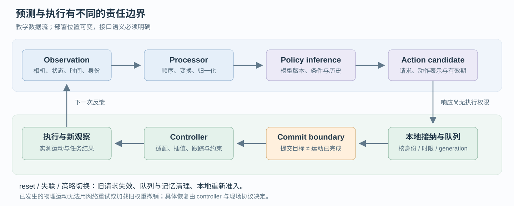

# 具身部署与执行：让预测在正确的时刻成为动作

[核心入口](embodied_infra.md) · [学习路线⑥](../roadmap.md#stage-6) · [训练](embodied_training.md) · [仿真与评估](embodied_sim_evaluation.md)

本章解决一个具体问题：**模型已经能输出 action chunk，怎样判断它现在还能不能执行？** 先读懂一条请求、一个动作队列与一个部署包，再进入[进阶平台设计](agentic_for_embodied.md)。下文是教学契约和工程推导，不是某个框架的统一 API；没有运行机器人、GPU 或闭环实验。

<a id="path"></a>
## 1. 问题与机制：预测完成只是中间事件



| 环节 | 消费与产生什么 | 必须保留什么 |
|---|---|---|
| 传感器与同步 | 各相机、关节状态 → observation bundle | 每路采集时刻、相机身份、时钟域、缺帧情况 |
| Processor | 原始观察 → 模型张量 | resize/crop、颜色范围、state 顺序、normalization 版本 |
| Policy inference | 条件张量 → action chunk 候选 | request、episode、模型版本、动作表示与预测时间约定 |
| 本地队列 | 候选 → 可替换的未来动作 | 已提交边界、有效时间、当前执行 generation |
| Adapter / controller | 模型动作 → 可跟踪的目标 → 实际运动 | 坐标、单位、控制模式、限幅与实际执行反馈 |

**候选生成、队列接纳、向 controller 提交、物理执行完成是四个事件。** 向 controller 提交一个目标，可能只意味着目标进入插值或控制队列；不能立即把它记作已执行。远程推理响应也不能自行获得本地执行权限。

如果动作已经在设备上生效，重试网络请求不会撤销那次运动。因而服务端的 retry / cancel 语义，必须通过本地的请求身份和提交边界解释，不能直接套用无副作用的 HTTP 查询模式。

<a id="time-budget"></a>
## 2. 时间算例：forward 40 ms，为什么动作年龄是 80 ms

沿用模型入门的教学配置：两路图像、`H=4`、动作步长 `Δt=50 ms`，每次计划执行 `K=2` 步。这里仅计算时间，不假定某种策略已能补偿延迟。

下面是一条**假设的串行 trace**，所有时刻已对齐到同一个单调时钟：

| 累计时刻 | 事件 | 本段耗时 |
|---:|---|---:|
| 0 ms | 选定 observation 的采集时刻 | — |
| 12 ms | 同步、预处理和传输准备完成 | 12 ms |
| 17 ms | 请求到达并开始推理 | 5 ms |
| 57 ms | 模型 forward 完成 | 40 ms |
| 60 ms | 反归一化、动作适配完成 | 3 ms |
| 70 ms | 响应接收并通过本地接纳检查 | 10 ms |
| 80 ms | 相关目标实际开始执行 | 10 ms |

本例 forward 是 40 ms，候选接纳时 observation age 是 70 ms，执行时 observation age 是 80 ms。对多相机还应保留各路年龄和最大 skew；用 bundle 的一个时间戳可能隐藏某一路陈旧图像。

```text
observation_age_at_execution = execution_time - observation_capture_time
nominal_prediction_duration = H × Δt = 200 ms
nominal_execution_duration  = K × Δt = 100 ms
```

后两个量是模型/执行协议里的名义跨度，不是保证的 wall-clock 间隔。减少 `K` 可以更频繁利用新观察，也会提高重规划压力；增加 `H` 可能增加可用队列长度，也会增加远期预测误差和计算成本。

特别要问：**训练标签是相对观察时刻，还是延迟后的执行起点？** 将一段原本针对观察时刻预测的动作整体后移 80 ms，并不能自动保持策略正确。需要延迟建模、动作衔接方法或受控闭环实验支持；runtime 给动作补时间戳不等于模型学会了延迟补偿。

这张表只允许把同一次请求、互不重叠的阶段耗时相加。并发流水线要看关键路径，端到端 p99 要从完整 trace 分布计算；各阶段 p99 相加一般不是端到端 p99。跨机器还需记录时钟映射与误差，不能直接相减两个未经校准的 wall clock。

<a id="queue"></a>
## 3. 队列机制：哪些动作可以替换

先定义三个区间：已经执行的历史、已交给 controller 的不可随意撤回区间、仍由 runtime 管理的未来候选。后两者的分界取决于 controller 能力和协议，不能从数组是否 `pop` 猜测物理进度。

| 机制 | 主要解决什么 | 仍需验证什么 |
|---|---|---|
| 同步重规划 | 先生成、再执行一段，容易建立基线 | 推理等待、观测陈旧与段间停顿 |
| 异步预测 | 执行旧段时准备新段，减少空等 | 队列耗尽、重叠段合并、乱序和旧请求 |
| RTC | 生成时约束预计会执行的前缀，并补全后续动作 | 具体 policy/动作表示适用性与延迟估计 |
| 反馈模块 | 利用执行中的新观察修正动作生成 | 是否需要训练、修正位置与完整反馈时延 |

[LeRobot async 文档](https://huggingface.co/docs/lerobot/en/async)提供 prediction / execution 解耦的实现入口；[RTC v1](https://arxiv.org/abs/2506.07339v1)讨论冻结执行前缀与后续生成；[VLA-Feedback](../../research/tracking/backfill/2026-09.md#embodied-followup-2609-21022)则是训练反馈模块。三者作用层次不同，不能把“有 action queue”写成已经实现 RTC。

**截掉旧 chunk 的前几步并非通用操作。** 若输出是相对上一姿态的增量，后缀可能依赖被删掉的运动；即使输出绝对目标，也仍要检查当前姿态、时刻和可达性。重叠动作求平均同样要匹配坐标与旋转表示；对任意 7 维向量直接平均没有通用正确性保证。

### 一个队列容量判断

假设在新观察可用、请求刚发起的同一时刻，剩余可执行动作覆盖 100 ms，而从该时刻到新候选可接纳需要 120 ms，则这次请求无法在耗尽前补位，快一些的平均 forward 也不能改变本次事实。若请求已经运行了一段时间，应比较预计完成时刻与队列耗尽时刻，不能拿剩余覆盖直接减去完整请求耗时。

调参时先记录剩余动作的**目标时间覆盖**、请求尾延迟和缺口，再决定提前请求、减少生成成本或调整执行方案。不能仅凭队列元素数判断可用时间，也不能无条件降低执行频率：这可能改变模型训练时的动作间隔及 controller 约定。

<a id="stale-response"></a>
## 4. 具体反例：请求顺序正确，响应仍可能属于旧任务

以下 `generation` 是教学用的执行会话代数：reset、失联后重建或策略切换会使旧会话失效。它不同于模型训练 step，也不是要求所有框架采用这个字段名。

| 时刻 | 事件 | runtime 应能解释的结果 |
|---:|---|---|
| 0 ms | episode A、generation 7 发出 Q17 | 保存请求、观察和 artifact 身份 |
| 20 ms | 同一会话发出 Q18 | 新请求不抹掉旧请求的审计信息 |
| 60 ms | Q18 返回 | 只在身份、时限和提交边界都满足时接纳；返回本身不是执行 |
| 90 ms | episode A 结束；reset 使 generation 8 生效 | 清理旧候选、请求映射和策略记忆，检查 controller 剩余状态 |
| 110 ms | Q17 才返回，模型版本未变 | 拒绝：模型相同仍属于旧 episode / generation |
| 120 ms | 网络自动重连 | 重连不自动恢复旧动作权限；需重新满足本地 readiness |

本例的旧动作不应成为 episode B 的起始动作。若没有 reset，而 Q17 晚于 Q18 返回，也不能按“最后到达覆盖全部队列”处理；需要检查其观察时间、有效执行区间和已经提交的目标。

[LeRobot #4937](https://github.com/huggingface/lerobot/pull/4937)是请求身份、执行代数与本地权限分离的具体证据；核验范围见 [10/14 扫描](../../research/tracking/frontier_scan_2026-10-14.md)。其实现只有一个 pending request 槽位，不能把上面的多请求反例解释为该版本已实现通用乱序重排。其 canonical action 表示也不自动等于绝对姿态；向量校验不证明任意增量动作都可截断重用。以上时间表是教学设计，不声称逐行对应上游实现。

<a id="artifact"></a>
## 5. 配置指导：部署的是一组互相兼容的工件

训练 checkpoint 负责继续优化；部署包负责把观察解释成当前机器人可消费的动作。两者有重叠，但消费方和验收目标不同。

| 工件组 | 最少记录什么 | 漏掉后可能发生什么 |
|---|---|---|
| 模型与 runtime | 权重 digest、adapter、导出/编译版本、精度与支持 shape | 换了计算图或精度，却继续用旧验收报告 |
| 输入处理 | camera order、尺寸/裁剪、颜色范围、tokenizer、state 顺序 | 同一现场产生不同模型输入 |
| 动作语义 | 动作表示、坐标、单位、normalization、夹爪约定 | 数值看似正常，实际方向或幅度错误 |
| 机器人接口 | robot profile、标定、controller 与 firmware 约定 | 同一模型在不同机器上出现偏移 |
| 执行与验证 | 时限、队列衔接方式、评估协议与结果版本 | 无法确定新的包是否满足原控制条件 |

建议先核对训练与部署的共同预处理语义，再在固定 observation fixture 上比较同一 checkpoint 的参考推理路径与部署路径：固定 eval 模式、输入、初始 noise／随机性、solver／采样 timestep 及后处理，逐层检查输入、输出与反归一化结果。Diffusion／Flow 的训练输出可能是噪声条件下的 velocity，部署输出则是采样动作，不能直接要求两者数值相等。随后再做日志回放、仿真和闭环评估；这个顺序用于定位差异，不能用离线 parity 替代实际任务能力。

量化、减少采样步、图编译、batching 或远程推理都是配置选择。每次只改变可归因的一组因素，同时看输入/输出差异、端到端时延与任务结果。把不同机器人请求合批还应检查每个请求的等待预算；提高总体 QPS 可能损害其中一个机器人的动作时限。

### 发布与恢复的边界

切换 artifact 时需要明确切换点、队列和记忆清理、兼容性检查及本地重新准入。若切换失败，回滚的是工件与运行状态；已经发生的物理运动无法通过加载旧权重撤销。恢复、reset 和独立 controller 的责任应在部署协议里分别写明，相关平台设计见[部署状态机](agentic_for_embodied.md#84-robot-runtime-state-machine)。

<a id="troubleshooting"></a>
## 6. 生产陷阱与排查顺序

| 现象 | 先核证据 | 再考虑优化 |
|---|---|---|
| 离线动作误差小，上机系统性偏移 | processor/stats、坐标、单位、关节顺序与标定 | 模型或数据分布差异 |
| 平均推理很快，偶尔断动作 | 完整请求尾延迟、队列目标时刻、丢包/慢帧 | 有界预取、调度或生成成本 |
| 重规划时突然跳变 | 新旧段时间对应、动作表示、已提交区间 | RTC 或经过验证的衔接机制 |
| reset 后出现上次任务动作 | episode/generation、迟到响应、策略记忆、controller 状态 | 改善失效与清理协议 |
| 换模型后只在部分机器人失败 | artifact 与 robot profile / firmware / camera 配置 | 分组回归和版本隔离 |
| 量化后局部误差小，闭环却下降 | 完整动作序列、接触场景、尾延迟和重复试验 | 精度、模型或控制配置的受控消融 |

排查时按同一 `episode→observation→request→candidate→commit→execution` 串起记录。先证明身份和时间对应，再分解计算与排队。没有实际执行反馈时，只能报告“已提交到 controller”，不能填“机器人已完成动作”。

<a id="mastery"></a>
## 7. 学完应能交付什么

完成[契约练习 E6](../../practice/experiments/embodied_contract_lab.md#e6)，留下三样产出：

1. 一张真实含义明确的时间表：采集、推理完成、接纳、提交与执行分别何时发生。
2. 一个迟到响应反例：解释模型版本相同为何仍应拒绝旧任务动作；指出谁有重新准入权限。
3. 一份部署包清单：对每一项说明由哪个训练或数据版本产生，以及怎样验收兼容性。

自测：`H=4` 是否等于 4 次模型调用？请求取消是否等于动作撤回？将 stage p99 相加是否得到端到端 p99？相对增量动作能否随便删前缀？答案应包含条件和一个反例，而不只是“不能”。

后续问题进入[共享学习记录](../../research/learning_log/2026-10.md#embodied-discussion)。具体平台服务与 fleet 设计留在 [Agentic for Embodied](agentic_for_embodied.md)，执行结果回到[评估账本](embodied_sim_evaluation.md#episode-ledger)；部署经验进入训练前，还要核[样本契约](embodied_data_io.md#sample-contract)。

## 8. 来源与证据层级

- [RTC v1](https://arxiv.org/abs/2506.07339v1)：Kevin Black、Manuel Y. Galliker、Sergey Levine，2025-06-09；动作分块与推理期间执行前缀约束。既有[6 月历史账本](../../research/tracking/backfill/2025-06.md)，本次没有新接受信号或复现。
- [LeRobot async 官方文档](https://huggingface.co/docs/lerobot/en/async)：2026-10-23 阅读当前文档，只用于理解 server/client、队列与预测执行解耦；示例参数不作为通用配置或固定版本保证。
- [#4937 固定版本的 remote inference 指南](https://github.com/huggingface/lerobot/blob/ae2b57f12223c8c5184fcd814eb63cd9ce7de203/docs/source/remote_inference.mdx)：该提交替换旧 async CLI，实际部署须匹配安装版本；不要混用网站旧示例与新入口。[同版本 RTC 指南](https://github.com/huggingface/lerobot/blob/ae2b57f12223c8c5184fcd814eb63cd9ce7de203/docs/source/rtc.mdx)区分 guided / trained 路径，后者的 prefix-conditioning 训练要求不能套用原 RTC 的无需重训结论。
- [VLA-Feedback 既有核验](../../research/tracking/backfill/2026-09.md#embodied-followup-2609-21022)、[LeRobot #4937 既有核验](../../research/tracking/frontier_scan_2026-10-14.md)：分别支撑反馈位置和请求/执行身份问题；来源测试不等于本仓库实测。
- 本章的时间数字、会话表、工件分组和排查顺序是教学假设或工程归纳，待按具体模型、controller 和任务验证。没有把队列设计当作完整机器人安全系统。
