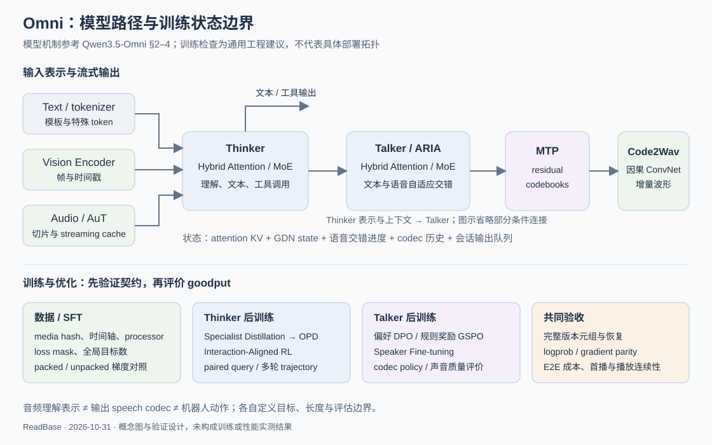

# Omni 模型算法与 Infra：从 SFT、RL 到实时交互优化

[Part 05](../README.md) · [专题学习路线](../roadmaps/omni.md) · [Qwen3.5-Omni 报告笔记](../../research/tech_reports/qwen35_omni.md) · [实验](../../practice/experiments/omni_sft_rl_lab.md)

## 问题定义：Infra 工程师要学到什么程度

目标是能够接手一条 Omni 后训练与服务链路：知道模型在学什么、数据和状态怎样流动、性能瓶颈在哪里，以及优化是否改变训练或交互语义。重点为音视频理解、文本/语音输出、SFT、蒸馏和 RL；机器人动作输出作为独立接口边界保留，不预设 Omni 自带关节控制能力。

**参考与边界**：以 [Qwen3.5-Omni v2](https://arxiv.org/html/2604.15804v2) 的公开机制为主要案例；架构事实、数字与披露边界集中在[报告笔记](../../research/tech_reports/qwen35_omni.md)。以下数据契约、公式、配置矩阵和优化顺序是通用工程设计建议，不是阿里或智元的内部实现说明。硬件、实际模型、代码栈和正式交付目标尚未假设。

三个最终验收问题：

1. 给定一个音视频对话样本，能从原始字节解释到 position、mask、loss、梯度和 checkpoint。
2. 给定一轮 RL，能解释 policy 输出什么、reward 评价什么、哪些版本必须一致，以及慢在生成、打分还是训练。
3. 给定“快了 20%”的结论，能查清 workload、质量、故障和计时分母是否一致；这里的百分比仅为验收提问示例。

## 机制：把模型拆成可检查的接口



图为本库概念图：上半部表达报告中的模型分工，下半部为工程验证建议；不表示已部署的具体拓扑。

### 输入、输出、目标与泛化边界

| 任务 | 输入 → 输出 | 学习信号 | 评估与泛化边界 |
|---|---|---|---|
| 音视频理解 | waveform / frames / text → text、时间戳、工具参数 | assistant response CE、配对蒸馏、任务 reward | 噪声/口音、长视频、跨帧事件、音视频冲突；ASR 好不等于听懂环境声 |
| 语音交互 | 多轮模态上下文 → text + speech codec → waveform | 文本/codec 目标、语音偏好、交互 reward | 内容正确、可懂度、自然度、语言与 persona 一致、延迟和打断 |
| Omni Agent | 模态输入 + 工具结果 → tool call / response | 成功结果、参数合法性、多轮任务反馈 | 工具版本、失败重试、外部等待计时；演示成功不等于稳健完成 |
| 机器人动作（扩展） | 观测/任务 → action chunk / controller command | imitation、flow/diffusion、闭环 reward，取决于实际 policy | 坐标系、单位、控制周期和真机评估，另见[具身模型入门](embodied_models_primer.md) |

语音 codec token 属于声学表示；RL 里的 action 可以指随机策略采样出的 token；二者都不能与机器人的物理动作混用。多模态 LLM 写作 **MLLM**，推理引擎写作 **vLLM**。

### 从样本到模型：时间轴也是训练数据

Qwen3.5-Omni 的 AuT 把音频压成低速率表示；报告 §2.3 给出约每 160 ms 一个 encoder frame（6.25 Hz）。**教学估算**：60 秒音频约 375 个 encoder frame；这不含文本时间戳、special tokens 和视觉 token，也不是 Talker 的输出 codec 速率。

视频 token 数还取决于抽帧、分辨率、patch/merge 规则；应由固定版本 processor 实际展开后计数。音视频很长而文本很短时，按文本字符数分桶会严重错估成本。

每条样本至少能恢复以下信息，字段名只是设计示意：

```text
sample_id, conversation_id, turn_id, split_id
media_uri + content_hash, clip_start/end, source_timebase
audio_sample_rate, channel_policy, frame_timestamps, sampling_policy
processor/tokenizer/template revision, augmentation_seed
model_input_ids, modality spans, position_ids, attention/sequence boundaries
target_ids, loss_mask, task/modality label, target_count
```

切片后保留原始时间与局部时间映射；不能在 dataloader 中对视频独立抽帧、对音频独立裁剪，然后假设对齐仍然成立。评估集按来源录音/视频、说话人或场景隔离，不能只随机划分同一媒体的相邻片段。

<a id="sft"></a>
### SFT：先明确谁在学、哪些位置进入 loss

SFT 的核心是条件分布：给定多模态输入与历史上下文，学习目标回答或语音序列。它不会自动补齐缺失的 encoder 对齐能力。建议逐步开启模块，便于定位问题：

| 阶段 | 候选训练范围（需算法确认） | 系统关注点 |
|---|---|---|
| 文本回答基线 | 先只更新 Thinker 或其 adapter；encoder/Talker 冻结 | 正确 multimodal forward、assistant mask、teacher forcing、模态回归 |
| 领域适配 | 根据领域偏差决定是否解冻 projector/encoder | activation、增强随机性、feature cache 失效、视觉/音频退化 |
| 语音生成适配 | Talker / MTP 等已确认模块；codec 是否冻结单独声明 | 多码本 target、stop 条件、音色条件、文本语音对齐 |
| 联合适配 | 有分支基准后再评估联合更新 | loss 配比、梯度冲突、总显存、版本发布与回归 |

对于声明采用“每种目标按有效位置均值”的设计，可写：

```text
L = λ_text · (Σ m_text · CE_text / N_text)
  + λ_codec · (Σ m_codec · CE_codec / N_codec)
N_k = Σ m_k，均覆盖全局 logical batch
```

这里的 codec 是经确认参与训练的 codebook/位置；不同 head 的平均方式会改变目标，不能未经确认把所有码本等权相加。没有某类目标时跳过该项，避免除零。loss 权重由任务设计决定，不是性能旋钮。

**教学反例**：rank 0 有 100 个有效目标、平均 loss 2；rank 1 有 10 个、平均 loss 4。简单平均 rank loss 得到 3；全局 token 均值为 `240/110 ≈ 2.182`。DDP 若默认对梯度除以 world size，每 rank 应对本地 loss sum 使用 `world_size / global_target_count` 缩放，才等价于全局目标均值；gradient accumulation 还需覆盖整个 logical batch，不能再机械除一次 microbatch 数。CP/TP 不重复计数复制的目标，DP/CP 的归约组和框架 loss 行为必须核查。推导复用[具身训练](embodied_training.md#loss-normalization)。

**Packing 的正确性条件**：独立对话不能跨样本 attention；音视频 span、position 与 loss mask 一起重排；Hybrid 模型还需在边界 reset recurrent state。只做 block-diagonal attention mask 不一定阻止 GDN 跨样本泄漏。先比较 unpacked/packed 的 loss 和梯度，再比较吞吐。

### 蒸馏：teacher 服务也是数据生产系统

Qwen3.5-Omni Thinker 用 specialist 数据整合能力，再用成对音频/文本 query 缩小输入模态差距，最后做交互 RL。报告第二阶段称为 OPD，但未披露足够细节去认定某个具体 KL objective；应先按[报告边界](../../research/tech_reports/qwen35_omni.md)理解，再设计本地实现。

工程迁移时，teacher cache 的 key 至少包括媒体内容、前处理、模态条件、prompt、teacher/version 与 decoding 配置。转录文本可能丢失情绪、环境声音或音视频冲突；“音频转文本后的 teacher 答案”不总是正确监督。建立 paired、noise、non-speech、conflict 四类对照；更多通用 teacher 供给问题见 [MOPD](../../04-rl-infra/topics/mopd.md)。

<a id="rl"></a>
### RL：将 Thinker、Talker 和联合策略分开

| 更新对象 | Policy action 与必要记录 | 候选 reward / 数据 | Infra 瓶颈与正确性 |
|---|---|---|---|
| Thinker | 实际采样的 text/tool tokens、旧策略 logprob、完整模态条件 | 可验证答案/工具结果、语言与 persona、多轮指令；具体 Thinker 算法未完整披露 | 长上下文 prefill、tool/reward 等待、partial group、truncation |
| Talker 偏好优化 | 固定上下文的 chosen/rejected speech 序列 | 报告披露多语言人标偏好对 + DPO | 不要求每 step 在线 rollout；长 codec 序列、reference logprob 和偏好配对成本 |
| Talker 在线 RL | 实际采样的 codec/交错序列、采样 head 与 mask | 报告披露规则奖励 + GSPO；可懂度、内容一致性等是本地候选，非已披露配方 | waveform 生成、ASR/judge、多个 codebook 联合 logprob、生成长度 |
| 联合策略（后续设计） | 可训练且随机采样部分的联合策略；冻结模块单列 | 联合任务与语音质量反馈 | 多策略版本、credit assignment、不同采样/更新频率；不是报告已公开 recipe |

基本闭环：固定 prompt/media → 采样 group → 解码/工具/打分 → 校验完整组与版本 → advantage/loss → update → 发布新版本。首个基线采用同步、可重放路径；只有发现供给等待且正确性基准成立，才评估异步与重叠。

通用 token importance ratio 是 `exp(logπ_new - logπ_old)`，前提是同一事件与条件。GSPO 使用序列层面的比率与目标设计，不能只把 PPO/GRPO 的 token loss 换个名字；本地实现必须核原论文/代码。Talker 多码本的概率分解、确定性或冻结分支是否参与 loss 也需明确，不能把 Code2Wav 波形处理本身当作 policy token logprob。

每条 trajectory 至少记录 `group_id / sample_id / policy_bundle / input_hash / processor_rev / old_logprob / action_mask / sampling_config / reward_version / termination_reason`。其中 `policy_bundle` 应覆盖 Thinker、Talker、codec、adapter、tokenizer/processor 的实际依赖。重新用同一版本做 teacher-forced scoring，首先检查 trainer 与 rollout 的 logprob 差异；temperature、top-k/top-p 或约束采样改变了行为分布，必须遵循算法规定的采样概率与校正口径。

**Reward 不能只优化一个总分**：ASR 一致性可能鼓励单调、过慢语音；自然度 judge 可能偏爱冗长回答；时间惩罚可能促使提前结束。保留各分量、超时和无效输出，冻结评估集，用独立任务结果与抽样人评校验。零方差 group、缺失候选、超时补样应显式定义；不能挑剩下的高分样本悄悄改变分布。

全双工、多轮语音 Agent 进一步见[专项训练正文](../../04-rl-infra/topics/full_duplex_voice_rl.md)：以公开模型与窗口 RL 为依据，补齐双音轨数据、接话／让话奖励、实际播放边界和完整会话训练；工程交付见[专项路线](../roadmaps/omni.md#duplex-project)，验证仍复用 [O4](../../practice/experiments/omni_sft_rl_lab.md#duplex-o4)，尚未执行。

<a id="serving"></a>
### 推理：优化用户可感知的关键路径

分阶段测量输入解码/encoder、Thinker prefill/decode、Thinker→Talker 等待、Talker/MTP、Code2Wav、网络与播放。**首文本、首 codec、首音频 chunk、首个可播放 packet 是四个不同事件**；多阶段重叠时不能相加局部耗时得到端到端时延。

`RTF = 生成耗时 / 输出音频时长`。RTF < 1 是可持续播放的必要参考，不保证低首包时延，也不保证 chunk 不抖动。首包 p50/p95/p99、chunk gap、underrun、取消传播时间与成功会话数共同约束容量。

状态不仅有 KV：还包括 GDN state、encoder streaming cache、ARIA 交错进度、Talker context、codec 卷积历史、输出队列和已播放边界。请求取消后停止上游生成并使旧输出失效；CUDA/通信未完成的 buffer 不可立即复用。旧轮次结果需被 session/turn/version 拒绝，防止用户打断后仍播放旧回复。

## 配置指导：先建立基线，再扩大系统

### 先填兼容性矩阵

对目标模型逐项记 `支持 / 不支持 / 未验证`，并绑定版本与证据；能加载 checkpoint 不代表支持训练，更不代表可在线 RL：

| 组件 | 必须核实 |
|---|---|
| 模型/processor | Thinker/Talker/codec 是否齐全、模板和特殊 token、音视频展开、许可证 |
| 训练 backend | forward/backward、Hybrid attention、MoE、冻结/LoRA、packed samples、loss/gradient parity |
| 并行 | DP、FSDP/ZeRO、TP/EP/CP 支持组合，GDN 跨序列 state 和 reshard |
| rollout backend | text + audio 路径、采样 head/logprob、输入 preprocessing、stop/cancel、流式会话 |
| 更新与恢复 | 所有训练模块导出、tensor mapping、adapter/codec 版本、optimizer/RNG/sampler、原子发布 |

Qwen3.5-Omni 报告没有给出可直接执行的完整开源训练 recipe。可用已核验的开放模型练习接口，但不能把 Qwen3-Omni 的运行结果写成 3.5 的复现。

### 容量与优化决策

| 观测 | 优先检查/候选修改 | 必须保持 |
|---|---|---|
| GPU 等数据 | 本地/远程 I/O、音视频 decode、worker 排队、缓存 miss；分片预取、有限并发 | 相同样本集合、抽帧/增强与随机种子；不能靠丢样提速 |
| rank step 长尾 | 展开后 token、帧数、音频时长与专家负载；cost-aware bucketing | 全局采样分布、loss 归一化、样本边界 |
| 显存峰值 | 参数/optimizer vs activation vs encoder 临时值；分片、selective recompute | 梯度/随机性一致；offload 的 Host 内存与带宽也入账 |
| MoE 通信受限 | dispatch/combine、热点专家、拓扑；按测量调整 EP/TP | routing 语义与有效训练 batch；active 参数少不等于全权重显存少 |
| rollout 等 reward | 分拆 queue/service latency；批量/缓存/独立资源 | reward 版本、输入身份、质量和失败分母 |
| 首包或 chunk 卡顿 | 各 stage 饱和点、batch 等待、prefill 抢占；有限队列与回压 | 模态内容、音质、SLO、取消正确性 |
| weight sync 昂贵 | 变更模块与传输量；按依赖发布完整版本元组 | 新旧组件不可混搭，校验后再准入 |

配置搜索顺序：最小模型/数据路径 → 单副本目标与状态正确 → 代表性单机 baseline → 分布式与恢复 → 一次一种优化 → E2E 质量/成本复测。不预填 GPU 数、batch、FP8 或并行度作为“推荐值”。

## 生产陷阱

1. **只看 text loss**：文本更准而漏词、音色漂移或跨语言退化；按任务/模态/语言分别记 loss 和评估。
2. **feature cache 成了旧标签**：encoder 解冻或增强改变后复用缓存，训练数据已不再匹配权重；cache key 必须含语义版本。
3. **减少帧率被算成系统收益**：这是数据/质量取舍，需单独做质量消融，不能放入等价 workload 的 speedup。
4. **Packing 只修 attention**：GDN state 没 reset，跨样本污染仍存在；同时检查位置、mask 和 recurrent state。
5. **RL mask 沿用文本模板**：audio/special/stop token 的生成和评分不一致，ratio/KL 异常；先对齐事件集合。
6. **checkpoint 只有主干参数**：Talker/MTP、adapter、processor 或 optimizer 缺失，加载成功却不能续训；用恢复后的下一个逻辑 batch 验收。
7. **局部 kernel 更快，首包更慢**：batch 等待或跨卡传递抵消收益；以固定质量与 SLO 下的 goodput 评价。

## 排障：先找语义差异，再看 kernel

| 症状 | 排查顺序 | 最小验证 |
|---|---|---|
| 加卡后 loss 变化 | 全局目标计数 → padding/mask → DP/CP 归约 → RNG/精度 | 固定 logical batch 的 loss 与一阶梯度对比 |
| 音画理解错误 | 媒体 hash → clip offset → timestamps → processor → position | 保存实际入模帧与音频片段，人工核对同一事件 |
| 语音漏词/重复/尾部丢失 | 文本-语音交错 → EOS/flush → codec state → chunk 去重/排序 | 固定文本与上下文，记录 codec、waveform 与播放时间线 |
| RL reward 升而效果退化 | reward 分量 → 数据筛选 → group 完整性 → held-out 对照 | 固定任务、独立指标、失败/超时全分母 |
| 首包尾延迟高 | 排队 → decode/encoder → prefill → Talker 等待 → Code2Wav/网络 | 统一 trace_id 的端到端关键路径 |
| 恢复或 refit 后声音改变 | 模块版本元组 → speaker 条件 → codec/template → cache | 固定输入对比恢复前后输出/概率，验证新版本准入 |

这里是诊断入口；真正生产 runbook 需补实际平台命令、日志关键词与权限，再进入 [playbooks](../../practice/playbooks/README.md)。本次未虚构可直接用于内部集群的命令。

## 相邻系统：复用已有积累，补齐 Omni 特有部分

| 既有积累 | 复用入口 | Omni 新增约束 |
|---|---|---|
| 长上下文与并行 | [长上下文](../../02-training-infra/topics/long_context_training.md)、[FSDP](../../02-training-infra/topics/fsdp.md)、[MoE](../../02-training-infra/topics/moe.md) | 多模态展开与分桶、Hybrid state、按目标归一化 |
| RL 系统 | [Agentic RL](../../04-rl-infra/topics/agentic_rl.md)、[框架选择](../../04-rl-infra/topics/rl_framework_selection.md)、[MOPD](../../04-rl-infra/topics/mopd.md) | 多码本 policy、成对模态蒸馏、声音偏好与多组件版本 |
| 推理状态 | [推理状态](../../03-inference-infra/topics/inference_state.md) | 多阶段队列、语音首播、codec 历史、取消与回压 |
| 具身数据/执行 | [数据 I/O](embodied_data_io.md)、[具身训练](embodied_training.md)、[实时执行](embodied_runtime.md) | 复用时间和身份契约，物理动作仍需独立 policy 与验证 |

沿[六阶段路线](../roadmaps/omni.md)学习；原始材料决策只维护在 [P1](../../research/reading_queue/P1.md#omni-20261031)，实测证据只进入 [O0–O6](../../practice/experiments/omni_sft_rl_lab.md)。目前完成正文和实验设计，没有训练、RL 或服务性能结果。

工程判断另见[先固定目标与状态，再比较速度](../../research/insights/omni_optimization_contracts.md)：列出适用边界、反证与 O1–O6 的验证关系，尚未验证。
